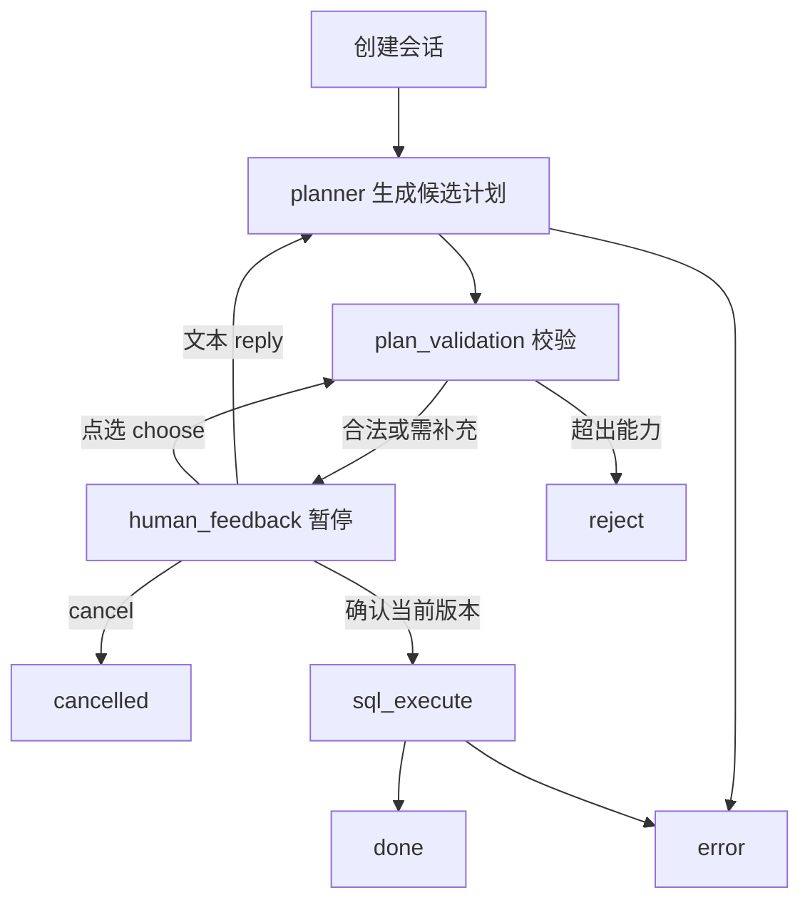

# 小哲电商 Text2SQL Python 迁移规划

日期 2026-11-20 · 状态 设计与实施计划

## 1. 目标与迁移边界

以 `text2sql-course/lessons/16/end` 为基线。第 16 课沿用第 15 课业务代码，并提供独立 SQL 与验收材料。Python 版复刻最终应用的可见行为，包括自然语言提问、计划与证据校验、澄清、人工确认、取消、旧卡拦截、会话恢复、只读查询、网页结果和 CSV。新增可查阅的结构化 trace。交付顺序先跑通固定计划，再接真实模型，最后用既有页面与三道独立 SQL 验收。

首版范围是本地及受控内网验证。部署采用单进程、单 worker，生产多实例协调、模型评估、Langfuse、报表扩张及结构化表单直提计划留在后续范围。单元、集成和上线验收是功能验证，首版照常做。真实模型用例只用于验证链路及展示当前偏差，暂时没有评分器、评测库或自动打分。

| 资产 | 复用决定 |
|---|---|
| Text2SQL 网页 | 复用 V16 的 `index.html`、`app.js`、`style.css`，原样打包，由 FastAPI 在同一 origin 提供静态文件。确认卡、结果、CSV 与刷新恢复继续消费原接口。Trace 从独立 API 查看 |
| MySQL | 复用 `text2sql_course`、课程数据、表结构和 `course_reader` 只读账号。宿主运行可配 `127.0.0.1:13323`，容器运行则根据实际共享网络配置服务地址。独立 CI 可从课程初始化数据创建隔离实例 |
| Redis | 复用 Redis 保存进度这一方案。Java Compose 使用 `redis:7.4-alpine`。拟用的 Python 保存器需要 JSON 与搜索能力，验收环境为 Python 单独部署具备两项能力的 Redis，独立卷、网络和服务名。原 Java Redis 与卷保留 |
| 旧会话 | 新部署用独立 origin 和新 checkpoint，Java/Python 的 checkpoint 格式各自管理。切换时先完成或取消 Java 的待确认查询，Python 从新会话开始。若最终复用原 origin，验证旧 localStorage ID 得到可处理的 404，用户可点击现有「新建会话」恢复使用 |
| 业务资源 | 从 V16 固定版本拷贝业务目录与三份静态资源并登记哈希。SQL 配置、提示词、输出 schema 各自版本化。提示词可针对模型适配修改，SQL 口径和网页兼容性有回归约束 |

方案取舍。直接逐类翻译 Java 能较快对照，但会把 Spring 注入、图状态表示与 HTTP 控制器的耦合一并带入。推荐按业务职责重建 Python 后端，保持对外协议，并用课程数据逐行验收。Redis 适配有两条路。用兼容实例与官方保存器，维护成本较低，增加一个本地容器。基于原 Redis 7.4 自写保存器，需要正确实现 checkpoint、pending writes 和恢复语义。首版选官方保存器及独立兼容实例，预检实际的 `JSON.SET`、`FT.CREATE` 与保存器初始化结果，避免只凭镜像标签判断。 [Redis checkpoint 官方项目](https://github.com/redis-developer/langgraph-redis)

## 2. 技术选型和目录

FastAPI 管 HTTP、静态资源及应用生命周期。LangGraph 管节点、条件边、暂停和从 checkpoint 恢复。LangChain 只用于 Ollama 模型适配，优先用 `langchain-ollama` 的 `ChatOllama` 和结构化输出。SQL、证据规则与人工确认均由应用代码负责。Python 3.12、Pydantic、Uvicorn、MySQL Connector/Python、redis-py 和 pytest 是拟用组合。依赖锁文件在首阶段生成，以兼容性验证确定具体版本。首版选择同步驱动、FastAPI 同步业务路由和 LangGraph 同步调用，减少同步与异步资源混用。应用 lifespan 组装并关闭连接与图资源。 [FastAPI 生命周期](https://fastapi.tiangolo.com/advanced/events/) · [静态文件](https://fastapi.tiangolo.com/tutorial/static-files/) · [ChatOllama](https://docs.langchain.com/oss/python/integrations/chat/ollama)

```text
text2sql/
  pyproject.toml
  .env.example
  compose.yaml
  docs/
  src/t2s/
    main.py                          # create_app、生命周期、组装依赖、静态挂载
    settings.py                      # 环境配置
    api/
      schemas.py                     # V16 HTTP 请求和响应
      routes.py                      # sessions、choices、health
      trace_routes.py                # 公开 trace 查询
    sessions/
      service.py                     # 创建、读取、回复、并发及版本边界
      models.py                      # Session、Reply、Choice
    workflow/
      graph.py                       # StateGraph、节点和条件边
      state.py                       # 可持久化状态、领域对象转换
      checkpoint.py                  # Redis 保存器初始化、版本隔离
    planning/
      models.py                      # Decision、Plan、Evidence
      catalog.py                     # 业务目录和模型可见摘要
      planner.py                     # Planner 协议及 Ollama 适配
      rules.py                       # 计划检查、选表、点选合并
      evidence.py                    # 原话和指标检查
      dates.py                       # 固定业务日期、区间解析及标准化
    query/
      compiler.py                    # 已通过校验的 Plan → 参数化查询
      executor.py                    # 连接池、执行、结果转换和资源限制
    observability/
      trace.py                       # 事件、字段白名单、安全摘要与记录器
      store.py                       # Redis 事件存储及日志降级
    resources/
      catalog/semantic-model.json
      prompts/
      web/                           # V16 原样资源
  tests/
    unit/
    integration/
    acceptance/
```

依赖方向是 HTTP → 会话服务 → 工作流 → 规划与查询组件。规划规则和 SQL 编译器接受显式目录与数据对象，单独运行时无需 FastAPI、LangGraph、Redis、Ollama 或数据库。应用组装层注入规划器、查询执行器、图保存器和 trace 记录器。控制器处理 HTTP 错误映射和 DTO 转换，业务节点不依赖 HTTP。会话服务持有并发边界，图处理业务阶段与路由。Trace 通过注入记录器接受结构化事件，业务状态的判断由业务代码完成。

| 核心接口 | 职责 |
|---|---|
| `Planner.interpret(messages) -> Decision` | 可换 `FixedPlanner` 或 Ollama 实现，给出候选决策 |
| `check_decision(session, catalog) -> Session` | 复刻校验、证据及阶段变换 |
| `apply_choice(session, choice, catalog) -> Session` | 保留未修改的指标、分组和筛选，确定性补齐 |
| `compile_sql(plan, catalog) -> CompiledQuery` | 基于校验通过的计划，返回 SQL 和有序参数 |
| `QueryExecutor.execute(query) -> Rows` | 只读访问业务库，统一结果类型和错误映射 |
| `SessionService.create/get/respond` | 实现原 API 会话行为，封装图调用 |
| `TraceRecorder.emit(event)` | 规范化并记录公开执行事件 |

## 3. API 兼容性与会话状态

| 外部入口 | Python 行为 |
|---|---|
| `GET /` 和原静态资源 URL | 同源提供 V16 网页。API 路由先注册，静态挂载最后注册 |
| `GET /health` | 保持 `{"status":"ok"}` 的健康检查响应。新增 `/ready` 验证 Redis 与 MySQL 连通及目录加载，模型连接用独立烟测 |
| `GET /choices` | 保持原指标 ID 和中文文案，保留 `other` 引导文字回复 |
| `POST /sessions` | 接收 `{"question":"..."}`，返回创建后的完整会话 |
| `GET /sessions/{id}` | 读取已有状态。过期、不存在或跨部署遗留的 ID 返回 404 |
| `POST /sessions/{id}/respond` | 接收 `revision/action/text/choice`，兼容 `confirm/cancel/choose/reply` |
| `GET /sessions/{id}/trace?after=0&limit=100` | 开发环境通过本机或受控访问读取安全事件，响应包含 `events` 与 `next_after` |

会话输出保留 `id, stage, reason, revision, executions, messages, decision, choice, warnings, rows`。决策保留 `status/reason/missing_fields/plan/tables/evidence`，计划保留 `metric/start/end/dimension/category/end_inclusive`。初始 `revision=0`、`executions=0`。缺项保持 null 或空数组，与原前端读取方式一致。日期分组为字符串，课程整数金额与计数序列化为 JSON 数字，结果保持二维数组。编写 HTTP 契约测试覆盖 null、日期、整数、空行及 JS 读取的字段。

外层 `stage` 驱动页面，`decision.status` 表示业务决策。业务拒绝或澄清维持原来通过会话响应表达的方式。无效输入及不适用动作映射为 400，旧 `revision` 或离开等待阶段返回 409，未知 ID 返回 404，依赖不可用按边界返回 503 或可展示的会话错误。FastAPI 请求校验错误为兼容旧前端应归一到 400。内部异常只报告稳定错误码和安全提示，详细原始异常不进入页面或公开 trace。

## 4. LangGraph 流程与恢复规则



1. 创建会话生成 UUID，将会话 ID 设置为 LangGraph `thread_id`。图状态保存在 Redis checkpoint。状态包含业务阶段、消息、决策、用户点选、版本、警告及结果。
2. `planner` 对本次消息历史产生候选决策。固定适配器先验通节点，再接 Ollama。模型仅得到目录摘要，由应用显式注入该摘要并记录 `catalog_loaded`，首版一次结构化调用。Java 的 `read_catalog` 工具提供同类目录数据，这个实现选择可减少本地模型工具与结构化输出同时出错的机会。Trace 如实标记目录注入，实际没有工具调用时不记工具执行。
3. `plan_validation` 重现 V16 的组合白名单、日期跨度 1 至 366 天、快照日、所需表和原话证据检查。以规范化后的 `[start,end)` 进行日期比较，澄清点选日期已是排他末日。用户补日期保留原始指标、分组、品类，补指标后重算所需表，仍需检查新指标与原分组是否兼容。先迁移固定规则和课程用例同时记录已知覆盖边界，例如自然语言日期解析范围。
4. `human_feedback` 用 `interrupt()` 暂停在 `confirm/clarify`，用相同线程配置和 `Command(resume=...)` 推进。恢复会从节点起点重跑，暂停前不执行 SQL、不修改版本、不发不可重复的副作用。路由控制在一个人工节点内。读状态只调用图状态读取，重启后点确认前保持原卡和零执行。
5. 会话服务以会话 ID 取本地锁，在锁内读取当前状态、比较版本和允许动作，再恢复图。人工节点从校验通过的回复更新版本一次。确认只接受 `confirm`，点选只接受 `clarify`。取消终止，文字回复带原历史重规划。用两个并发请求验证一个成功、另一个 409。锁只覆盖单 worker，部署配置固定为 1。
6. 数据库节点要求内部状态为 `approved`，使用服务端存档里的计划。为处理 SQL 已发出但后来 checkpoint 写入失败的情况，在 Redis 为 `会话ID + 已批准版本` 保存一次执行领取，领取成功后才访问 MySQL。成功的结果和计数由图 checkpoint 写回。若进程中断且只有领取记录，状态标记为执行结果未知或提供对应的只读诊断，禁止自动重发 SQL。首版由用户新建会话重新明确确认。正常重复确认不会再查库，故障时取保守处理，本方案不对跨 Redis/MySQL 的严格精确一次执行作承诺。验收覆盖被领取后崩溃及查询完成后写 checkpoint 失败。

执行时检查 Redis 持久化与命名卷，明确在 app 进程重建场景保留 Redis 数据。给 checkpoint 状态和图定义设版本，未来改变中断节点位置或状态结构时，先考虑待恢复会话如何处理。 [LangGraph 中断与恢复](https://docs.langchain.com/oss/python/langgraph/interrupts) · [LangGraph 持久化](https://docs.langchain.com/oss/python/langgraph/persistence)

## 5. SQL 与模型边界

沿用业务目录中的 `paid`、`count`、`net`、`shipped_orders`、`stock_qty` 及对应维度。编译器使用固定指标定义及组装分支。连接表、时间列、聚合表达式来自仓库中的受控目录，日期和品类走 MySQL 驱动参数。Python 的 Connector/Python 用 `%s` 占位并调用 `cursor.execute(text, params)`。净额按订单聚合已完成退款，含跨月退款，再左连订单。品类金额从订单明细取值。库存按指定快照日。 [MySQL Connector/Python 参数绑定](https://dev.mysql.com/doc/connector-python/en/connector-python-api-mysqlcursor-execute.html)

执行器用现有只读账号、连接池、只读事务及查询超时。保留 MySQL `MAX_EXECUTION_TIME=1500` 和最多 1000 个结果行的行为。SQL 用 `LIMIT 1001` 检测超限，驱动网络超时另外配置。测试确认池连接归还、异常回滚和只读权限拒绝。模型适配器只产出受 schema 约束的候选决策，严格校验引用形状。本地历史测试出现过 `evidence["1"]`，Python 将这类输出标为格式错误或依据不足，固定测试覆盖对应处置。真模型默认可用 Ollama `qwen3.5:9b`，模型名和地址通过配置注入，异常路径提供可读反馈。

## 6. Trace 设计

参考小哲电商第 41 课的设计。`TraceEventNormalizer` 统一事件类型、时间、分类、阶段、安全摘要，`TraceStore` 按会话收集并提供查询。该示例存储在进程内。本项目采用按会话持久化的 Redis Stream，使用独立键前缀，与 checkpoint 生命周期分开管理。每个会话序号单调递增，API 支持游标分页。建议数量上限约 500 条、保存期 7 天，参数可配置。存储故障则记脱敏的结构化日志，trace 查询明确反馈受影响。整个链路会话 checkpoint 仍是业务状态来源。 小哲电商 Trace 实现 (agent-course-versions/lesson-41-final-rehearsal/backend/observability/trace.py) · 小哲电商相关路由 (agent-course-versions/lesson-41-final-rehearsal/backend/api/routes.py)

事件字段采用本项目版本 `t2s_trace_v1`。公共字段为 `event_id, step, timestamp, session_id, request_id, revision, category, name, stage, status, duration_ms, reason_code, summary`，按事件进一步限制摘要字段。一次恢复请求会产生新 `request_id`，沿用同一 `session_id`。完成或拒绝、模型错误、超时分别使用稳定的错误码。SQL 执行前后使用相同操作标识关联，可记录查询指标、维度和行数，也可记录无参数值的模板指纹。

| 分类 | 首版事件 |
|---|---|
| 请求 | `session_created`、`session_restored`、`revision_conflict` |
| 模型 | `catalog_loaded`、`planner_started`、`planner_finished`、`planner_failed` |
| 校验 | `plan_validated`、`plan_rejected`、`clarification_required` |
| 人工 | `approval_required`、`choice_applied`、`approval_accepted`、`session_cancelled`、`workflow_resumed` |
| 数据库 | `sql_compiled`、`sql_started`、`sql_finished`、`sql_failed` |

按事件采用允许字段列表，允许记录模型名、用时、状态、缺项、指标 ID、维度、行数、错误码。用户原话、模型原始响应、提示词、密钥、连接串、绑定值、完整结果和隐藏推理均排除在公开字段之外。通过节点回放、等待恢复和重试测试，确保 `approval_required` 等事件按会话与版本去重，终止事件显式区分成功与失败。Trace 证明实际经过的步骤，可在后续通过独立导出器接入 Langfuse。首版交付 JSON 查询与后端日志，无需改旧页面。

## 7. 实施任务与验收

每阶段先落测试样例，再完成模块。以下命令是实现后的验证入口。开发依赖与标记在第一阶段登记到 `pyproject.toml`。

| 阶段 | 文件与实施内容 | 验收 |
|---|---|---|
| 1. 基线与环境 | `pyproject.toml`、锁文件、`.env.example`、`compose.yaml`、`settings.py`、`main.py`。锁定依赖，记录 Java API 样本、资源哈希。验证现有课程 MySQL、兼容 Redis、Ollama 及环境变量 | FastAPI 启动和健康检查通过。Redis 保存器 `setup()`、创建/读取 checkpoint 的烟测通过。只读账号可查询课程库 |
| 2. 业务和查询 | `planning/` 的目录、模型和校验，`query/` 编译和执行。先用固定 `Plan` 执行，不依赖模型 | `pytest tests/unit`。含末日转排他、跨度边界、净额聚合、原话引用、点选条件保留、日期和品类绑定均通过。真 MySQL 用三道题逐行核对 |
| 3. 图与会话 | `workflow/`、`sessions/` 和 `api/routes.py`。先用固定规划器覆盖暂停、点选、回复、确认、拒绝、取消、重启恢复及异常执行领取 | `pytest tests/integration -m "not ollama"`。重建 Python app 后使用同一 ID 恢复消息、计划、点选、阶段和版本。两个相同版本的并发确认只执行一次。已完成会话 GET 只读取结果 |
| 4. Trace 与真实模型 | `observability/`、`api/trace_routes.py`、Ollama 适配、提示词。先验证各事件的实际触发和载荷，再验证真实模型的提问及追问 | 固定场景覆盖版本冲突、取消、正常执行、重启恢复对应的事件序列。敏感原文检查通过。真实模型至少成功完成 A01，并验证含糊口径或缺日期能进入澄清 |
| 5. 页面与交付 | 原样同步 `resources/web/`、补齐 HTTP 兼容性和部署说明，执行浏览器验收及课程标准 SQL 对照 | `pytest tests/acceptance`，同时保存浏览器截图、逐行对账、恢复记录和 trace 样例。用户确认后执行，刷新与导出不触发新查询 |

发布门槛按功能核对。A01 为 2026 年 9 月按天支付金额 30 行，A02 为 2026 年 7 至 9 月按月支付订单数 3 行，A03 为 2026 年 10 月 31 日库存按品类 3 行。行数只是定位线索，必须用同一课程数据与独立 SQL 比较每行分组与数值。用假规划器验明数据库和会话功能，再用真实 Ollama 通过同一入口跑至少一条完整链路。取消、旧卡 409、确认前零查询、补日期保留条件、重建后原卡仍待确认、只读权限、表格与 CSV 数值一致，均记录实际证据。模型输出异常、Redis 故障和 MySQL 超时要能从 trace 或后端日志定位。 课程独立 SQL (text2sql-course/labs/16-acceptance/独立标准.sql) · 课程验收记录模板 (text2sql-course/labs/16-acceptance/验收记录模板.csv) · 公开题与参考结果 (text2sql-course/demos/lessons/16/end/验收题与结果.json)

本地先用独立端口运行 Java 和 Python，使用同一份 MySQL 课程数据做只读对照，两边的 Redis 状态各自保存。Python 验收后再切换入口。回退时将入口指回 Java，保留各自的数据卷。切换前先处理待确认会话，尤其是状态不明的查询，以免用户误认旧卡可以跨后端确认。

## 8. 源码基线

- V16 会话接口 (text2sql-course/lessons/16/end/src/main/java/course/text2sql/SessionController.java)
- V16 工作流 (text2sql-course/lessons/16/end/src/main/java/course/text2sql/Workflow.java)
- V16 查询校验 (text2sql-course/lessons/16/end/src/main/java/course/text2sql/QueryRules.java)
- V16 SQL 编译器 (text2sql-course/lessons/16/end/src/main/java/course/text2sql/SemanticSqlCompiler.java)
- V16 查询执行器 (text2sql-course/lessons/16/end/src/main/java/course/text2sql/ReadOnlyQueryExecutor.java)
- V16 页面脚本 (text2sql-course/lessons/16/end/src/main/resources/static/app.js)
- V16 Compose (text2sql-course/lessons/16/end/compose.yaml)
